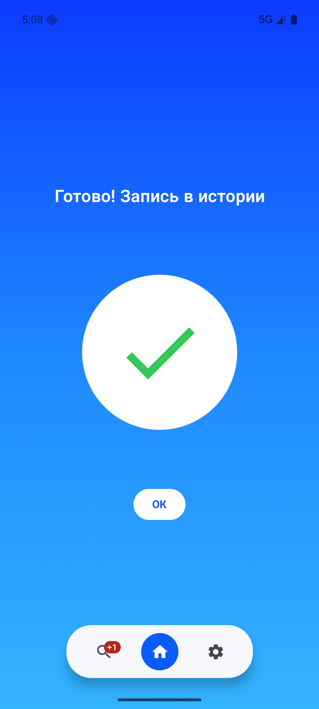
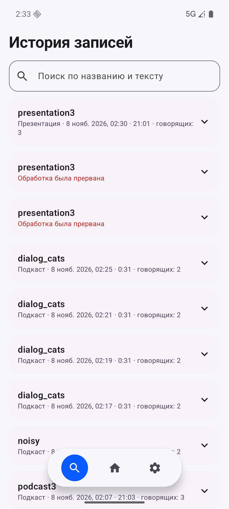
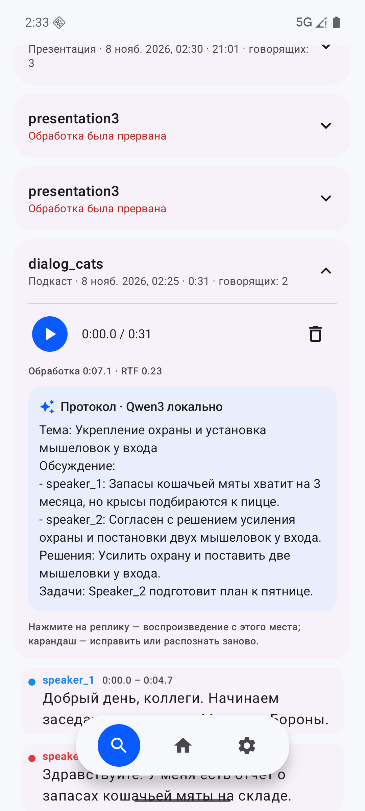

# Нейро-стенографист (Nuclear IT Hack, Команда Буримы)

Android-приложение, которое **полностью на устройстве и без интернета** превращает запись
разговора в структурированную расшифровку: кто говорил, когда и что сказал.
Главный экран - одна большая кнопка записи (и маленькая кнопка импорта файлов); все записи
попадают в историю, где расшифровку можно раскрыть, прослушать с переходом к реплике и скачать в JSON.

Три профиля обработки - модели и параметры подбираются под тип записи:

| Профиль | Для чего | Что меняется |
|---|---|---|
| **Подкаст** (по умолчанию) | разговор до 5 человек, 30 мин - 6 ч | шумоподавление, лимит 5 говорящих, реплики ≤ 60 с |
| **Музыка** | песни и альбомы (можно выбрать несколько файлов) | отделение вокала UVR MDX-Net, настройки VAD для пения |
| **Презентация** | спикеры выступают по очереди, 2 - 8 ч | сглаживание смены спикеров, реплики ≤ 30 с, протокол по выступлениям |

Длинные записи обрабатываются блоками по 10 минут в фоновом сервисе: можно свернуть
приложение и выключить экран, прогресс виден в уведомлении.

| Главный экран | История | Расшифровка |
|---|---|---|
|  |  |  |

| Этап | Модель / библиотека |
|---|---|
| Песни | автоопределение музыки + отделение вокала UVR-MDX-NET-Voc_FT |
| Шумоподавление | DPDFNet2 (адаптивно по SNR) + high-pass фильтр |
| Поиск речи (VAD) | Silero VAD через sherpa-onnx |
| Распознавание | GigaAM v3 RNNT с пунктуацией (Сбер), int8, beam search, sherpa-onnx; англицизмы латиницей |
| Диаризация | pyannote segmentation 3.0 + 3D-Speaker CAM++, слияние по отпечаткам ERes2NetV2, sherpa-onnx |
| Локальная LLM | Qwen3-1.7B Q4_K_M через llama.cpp (протокол заседания, редактура пунктуации) |

В манифесте **нет разрешения INTERNET**: аудио и текст физически не могут покинуть устройство.

## Результаты

| | |
|---|---|
| WER на тестовом диалоге | **5.8%** |
| Говорящие: диалог / подкаст 21 мин / презентация 21 мин / реальные голоса 2-10 чел. | 2 из 2 / 3 из 3, 91% / 3 из 3, 100% / 88.1% |
| Скорость на эмуляторе: диалог / подкаст 21 мин / презентация 21 мин | RTF 0.23 / 0.39 / 0.10 |
| Песня: сходство с текстом | 81.3% |

Подробно: [docs/TEST_RESULTS.md](docs/TEST_RESULTS.md). Готовый APK и демо-видео - в
[релизе на GitHub](https://github.com/pellewka/neuro-stenographer/releases/latest).

## Быстрый старт

```bash
cd src/android
./scripts/fetch_deps.sh        # модели (~1.3 ГБ) и llama.cpp
./gradlew :app:assembleRelease # APK: app/build/outputs/apk/release/app-release.apk
```

Подробно о сборке и запуске на эмуляторе: [src/README.md](src/README.md).

## Формат экспорта

```json
{
  "transcript": [
    { "speaker_id": "speaker_1", "start_ms": 1250, "end_ms": 4380, "text": "Добрый день!" }
  ]
}
```

Помимо кнопки скачивания в истории, каждая расшифровка автоматически сохраняется в
`/sdcard/Android/data/ru.hexteam.stenographer/files/transcripts/<название записи>.json`.

## Документация

- [Архитектура](docs/ARCHITECTURE.md)
- [Ограничения](docs/LIMITATIONS.md)
- [Тестирование](docs/TEST_RESULTS.md)
- [Соответствие ТЗ](docs/TZ_COMPLIANCE.md)
